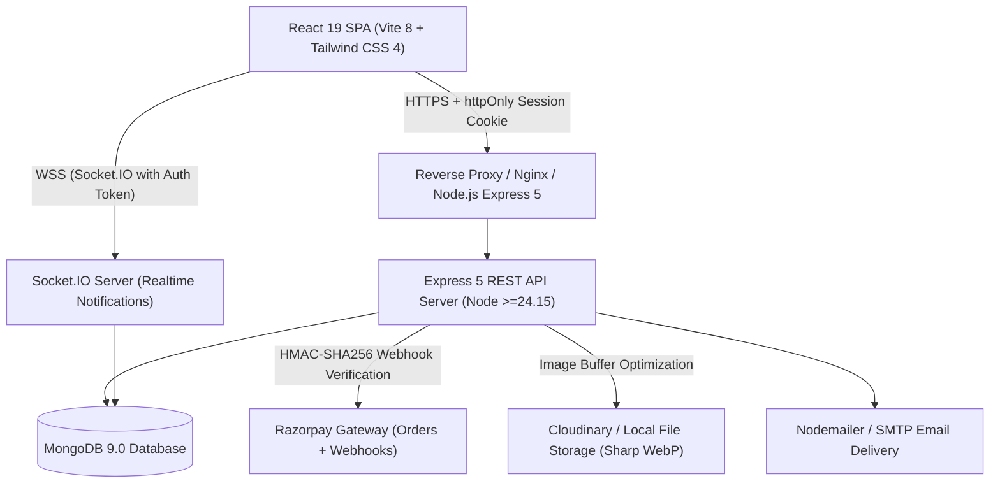

# Architecture Map: Royal Rajputana / Kshatriya Matrimonial Platform

## Executive Summary

This document establishes the end-to-end architectural blueprint of the Kshatriya Matrimonial platform ("Royal Rajputana Matrimony" / "Kshatriya Matrimonial Society"). The system is engineered as a privacy-first, community-specific matrimonial application serving Rajput and Kshatriya families across Gujarat, Rajasthan, and the global diaspora.

---

## 1. System Topology

---

## 2. Frontend Architecture

### 2.1 Technology Stack
- **Framework**: React 19.2.7 with React DOM 19.2.7
- **Bundler & Tooling**: Vite 8.1.1 with `@vitejs/plugin-react`
- **Styling**: Tailwind CSS 4.3.3 (`@tailwindcss/vite`) with custom typography scale and CSS variables
- **Routing**: `react-router-dom` 7.18.4 with route-level code splitting via `React.lazy` and `Suspense`
- **Animation**: GSAP 3.15.0 with custom `useGsapReveal` hook and `useReducedMotion` accessibility guard
- **Internationalization**: `i18next` 26.4.2 & `react-i18next` 17.0.15 supporting English (`en`), Gujarati (`gu`), and Hindi (`hi`)
- **Icons**: `lucide-react` 1.49.0
- **Realtime Client**: `socket.io-client` 4.8.4

### 2.2 Entry Points & Provider Hierarchy
1. `index.html`: Preloads web fonts (`Cormorant Garamond`, `Manrope`, `Noto Sans/Serif Gujarati`, `Noto Sans/Serif Devanagari`). Configures initial viewport and language metadata.
2. `src/main.jsx`: Initializes `i18n` instance, mounts React DOM root inside `StrictMode`.
3. `src/App.jsx`: Root router wrapper. Establishes:
   - `DocumentMeta`: Dynamic title and locale metadata synchronization
   - `LanguageSwitcher`: Global floating locale switcher with persistent selection
   - `ToastContext.Provider`: Accessible alert/notification dispatching
   - `AuthContext.Provider`: Global authentication state, session bootstrapping, role-based capabilities
   - `RealtimeBridge`: Socket.IO listener for live notification counters and interest/match state mutations

### 2.3 Route & Navigation Structure
- **Public Routes**:
  - `/`: Editorial Homepage with cultural heritage narrative, match preview showcase, and verification trust badges
  - `/login`, `/register`, `/forgot-password`: Unified `AuthPage` with client validation and rate limit feedback
  - `/membership`: Public tiers and plan feature comparison
  - `/about`, `/how-it-works`, `/safety`, `/privacy`, `/terms`, `/refunds`: Public information and trust architecture
  - `/contact`: Support inquiry form
  - `/success-stories`: Community testimonials with partner consent verification badges
- **Authenticated Member Routes (`/`)**:
  - `/onboarding`: 7-step guided profile builder (Basic, Personal, Community, Location, Career, Family, Privacy)
  - Layout: `MemberLayout` with responsive `AppSidebar` (expanded, hovered, collapsed, and mobile drawer)
  - `/dashboard`: Authentic operational dashboard (profile completeness, match recommendations, action queues)
  - `/discover`: Multi-criteria search, Clan/Gotra/Vansh filters, native district search, and boosted sorting
  - `/profile/:profileId`: Deep member profile with relationship-gated privacy tiers
  - `/my-profile`: Member's own profile inspection and section-by-section editing
  - `/my-profile/biodata`: Printable, shareable traditional biodata generator with configurable disclosure
  - `/interests`: Received, sent, and accepted matrimonial interest requests
  - `/matches`: Reciprocal mutual match workspace
  - `/shortlisted`: Bookmarked candidate profiles
  - `/notifications`: Real-time system and interaction activity ledger
  - `/boosts`: Profile boost wallet, activation controls, and commercial boost packs
  - `/benefits`: Plan entitlements, contact unlock usage, and upgrade pathway
  - `/story-consent`: Bilateral partner verification for public success stories
  - `/submit-success-story`: Submission workflow for betrothed couples
  - `/settings`: Privacy matrix, partner preferences, notifications, and account credentials
- **Operational & Administrative Routes (`/admin/*`, `/manager/*`)**:
  - `/manager`: Relationship Desk workspace for assigned Assisted membership clients
  - `/admin`: Moderation queue, profile approval/rejection with mandatory notes, user management, safety reports
  - `/admin/customers`: Customer 360 inspector (profile, subscriptions, payments, support history, audit logs)
  - `/admin/revenue`: Financial ledger (captured revenue, refunds, failed payments)
  - `/admin/boosts`: Boost pack configuration, credit grants, and commercial pricing rules
  - `/admin/support`: Ticket queue management and resolution notes
  - `/admin/relationship-managers`: Allocation of dedicated staff to Assisted members
  - `/admin/plans`: Membership plan management and feature matrix controls
  - `/admin/settings`: Global system toggle (maintenance mode, registrations, payments, limits)
  - `/admin/system-health`: Liveness, readiness, database connectivity, and provider health checks
  - `/admin/audit-logs`: Append-only security audit trail

---

## 3. Backend Architecture

### 3.1 Technology Stack
- **Runtime**: Node.js >=24.15.0 (ES Modules `type: module`)
- **HTTP Server**: Express 5.1.0
- **Database Engine**: MongoDB with Mongoose 9.0.0
- **Realtime**: Socket.IO 4.8.4
- **Security & Headers**: Helmet 8.1.0, CORS 2.8.5, Express Rate Limit 8.1.0
- **Authentication**: JSON Web Token (`jsonwebtoken` 9.0.2), `bcryptjs` 3.0.2
- **Media Engine**: Multer 2.0.2, Sharp 0.35.5 (WebP transcoding, EXIF stripping, dimensions bounding)
- **Payment Processor**: Razorpay Node SDK with custom HMAC-SHA256 verification and replay-resistant idempotency

### 3.2 Entry Point & Middleware Chain
1. `server.js`: Connects to MongoDB, seeds base plans and system settings if missing, starts HTTP server and attaches Socket.IO.
2. `server/src/app.js`: Express application setup:
   - Security headers: Helmet with Strict CSP (`defaultSrc: 'none'`, frameguard deny, no-referrer)
   - Trust proxy: Configured for reverse proxy environments
   - CORS: Explicitly validated against `CLIENT_URL` whitelist with credentials support
   - Logging: Morgan request logging in non-test environments
   - Rate limiters:
     - Global API Limiter: 5,000 req / 15m (dev) or 600 req / 15m (prod)
     - Auth Limiter: 30 attempts / 15m
     - OTP Limiter: 5 requests / 10m
     - Payment Limiter: 20 requests / 15m
     - Support Limiter: 10 tickets / 15m
   - Body Parsers: `express.json({ limit: '1mb' })`, `express.urlencoded({ limit: '1mb' })`
   - Static Uploads: Safe static serving with `fallthrough: true`, `index: false`, `dotfiles: 'deny'`
   - Central Error Handler: Normalizes `ApiError`, Mongoose `ValidationError`, `CastError`, and hides internal stack traces in production.

### 3.3 Data Layer & Domain Models
1. `User`: Account identity, hashed password (bcrypt cost 12), `tokenVersion` (for instant global session revocation), `role` (`member`, `moderator`, `relationship_manager`, `admin`, `super_admin`), `status` (`Active`, `Suspended`, `Blocked`, `Deleted`), terms/privacy acceptance ledger.
2. `MatrimonialProfile`: Core matrimonial identity with auto-incrementing `profileId` (`KSM-XXXX`), personal details, strict Rajput/Kshatriya community hierarchy (`community.name`, `community.clan`, `community.gotra`, `community.vansh`), native location (`nativePlace`, `nativeDistrict`, `nativeState`), structured family assets, lifecycle status (`Draft`, `UnderReview`, `Active`, `Paused`, `Suspended`), and granular `privacy` configuration.
3. `PartnerPreference`: Multi-factor search criteria (age range, height range, preferred clans/shakhs, gotra, vansh, native state, education, occupation, diet, smoking, drinking, family assets).
4. `Interaction` (`Interest`, `Shortlist`, `Match`): Bilateral matchmaking state machines with audit timestamps.
5. `Business` (`ContactRequest`, `PlanUsage`, `ProfileView`, `SupportTicket`, `SystemSetting`, `AuditLog`, `CustomerInternalNote`): Operational domain entities.
6. `Platform` (`Plan`, `Subscription`, `Payment`, `RefundRequest`, `Block`, `Report`, `Notification`): Commercial and safety infrastructure.
7. `Boost` (`BoostPlanConfig`, `BoostPack`, `BoostOrder`, `BoostCreditGrant`, `BoostActivation`): Organic discovery boost system.
8. `SuccessStory`: Couple matrimonial narrative with independent `partnerUser` consent verification.

---

## 4. Cross-Cutting Engineering Concerns

### 4.1 Authentication & Session Management
- **HttpOnly Cookies**: Browser clients authenticate using secure, httpOnly, sameSite cookies (`ksm_session`).
- **Token Version Invalidation**: Every JWT encodes `sub` and `ver` (`tokenVersion`). Any password change, reset, or administrative account suspension increments `user.tokenVersion`, immediately invalidating all outstanding tokens across all devices.
- **Role Isolation**: Strict server-side route guards (`protect`, `permit('admin', 'super_admin')`, `maintenanceGuard`). Client-side routing redirects unauthorized users to their designated landing page.

### 4.2 Privacy by Architecture
- **Relationship-Aware Serialization**: `serializeProfileForViewer` dynamically strips private contact information, maternal lineage, sibling details, astrology, and family assets unless reciprocal access criteria (`AcceptedInterests`, `MutualMatches`, `contactUnlocked`) are met.
- **Same-Surname / Gotra Safeguards**: Community exogamy rules (`sameSurnameMongoExclusion`) prevent displaying candidates sharing forbidden paternal lineage where prohibited by community tradition.

---

## 5. Identified Architectural Anomalies & Dead Code

1. **Redundant Admin Link**: `src/pages/admin/AdminPage.jsx` contains a static `<Link to="/admin/success-stories">` embedded directly above the admin `<Routes>` on every sub-route, duplicating navigation already present in `AdminNav.jsx` sidebar.
2. **Leftover Test Artifact**: `src/pages/admin/AdminPage.test.jsx.before-task004-fix` exists in the repository as dead historical debris.
3. **Mongoose Buffer Timeout in Test Suite**: Running all test files concurrently via `node --test` causes Mongoose connection pool conflicts across parallel test processes. Tests must either isolate connection instances or execute with explicit concurrency limits.
